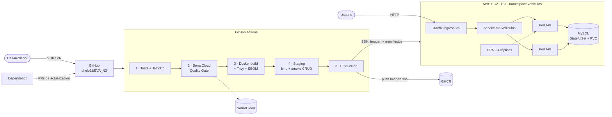
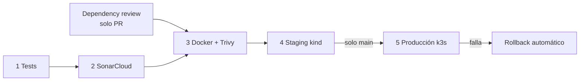

# EVA_N2 · Pipeline CI/CD del microservicio `ms-vehiculos`

[](https://github.com/chelo11/EVA_N2/actions/workflows/ci-cd.yml)
[](https://sonarcloud.io/summary/new_code?id=chelo11_EVA_N2)
[](https://sonarcloud.io/summary/new_code?id=chelo11_EVA_N2)
[](https://sonarcloud.io/summary/new_code?id=chelo11_EVA_N2)

**Asignatura:** DOY0101 Ingeniería DevOps · **Evaluación Parcial N°2:** "Añadiéndole complejidad a nuestro pipeline"

**Integrantes:** Marcelo Acevedo Alarcón · Daniel Ríos Valle

Pipeline CI/CD en GitHub Actions para el microservicio de vehículos de la EVA_N1: pruebas automatizadas, análisis de
calidad y seguridad, imagen Docker, validación en un clúster Kubernetes de *staging* y despliegue automático en
**producción (k3s sobre AWS EC2)**.

---

## Índice

1. [El microservicio](#1-el-microservicio)
2. [Arquitectura](#2-arquitectura)
3. [Estructura del repositorio](#3-estructura-del-repositorio)
4. [El pipeline paso a paso](#4-el-pipeline-paso-a-paso)
5. [IE1 · Contenedores](#5-ie1--contenedores)
6. [IE2 · Pruebas automatizadas y políticas de calidad](#6-ie2--pruebas-automatizadas-y-políticas-de-calidad)
7. [IE3 · Seguridad y escalabilidad en el pipeline](#7-ie3--seguridad-y-escalabilidad-en-el-pipeline)
8. [IE4 · Despliegue automático y trazabilidad](#8-ie4--despliegue-automático-y-trazabilidad)
9. [IE5 · Orquestación con Kubernetes](#9-ie5--orquestación-con-kubernetes)
10. [Justificación técnica de las decisiones](#10-justificación-técnica-de-las-decisiones)
11. [Cómo ejecutarlo](#11-cómo-ejecutarlo)
12. [Configuración requerida](#12-configuración-requerida)
13. [Declaración de uso de IA](#13-declaración-de-uso-de-ia)
14. [Conclusiones y reflexiones individuales](#14-conclusiones-y-reflexiones-individuales)

---

## 1. El microservicio

API REST de vehículos (Spring Boot 3.5, Java 21, MySQL 8.4) con documentación Swagger.

| Método | Ruta | Descripción |
|---|---|---|
| `GET` | `/` | Información de la API |
| `GET` | `/api/v1/vehiculos` | Listar vehículos |
| `GET` | `/api/v1/vehiculos/{id}` | Buscar por id (404 si no existe) |
| `POST` | `/api/v1/vehiculos` | Crear (400 si los datos son inválidos, 409 si la patente ya existe) |
| `PUT` | `/api/v1/vehiculos/{id}` | Actualizar |
| `DELETE` | `/api/v1/vehiculos/{id}` | Eliminar (204) |
| `GET` | `/actuator/health/liveness` · `/readiness` | Health checks que usa Kubernetes |
| `GET` | `/swagger-ui/index.html` | Documentación interactiva |

**Producción:** `http://<IP de la EC2>/swagger-ui/index.html`

## 2. Arquitectura



| Entorno | Dónde | Cuándo se despliega |
|---|---|---|
| Desarrollo | PC local con Docker Compose | Manualmente |
| Staging | Clúster **kind** efímero (Kubernetes v1.36) dentro del runner de GitHub | En cada PR y en cada push a `main` |
| Producción | **k3s v1.36** en AWS EC2 (Ubuntu, t3.medium) | Solo en `main`, si staging pasó |

## 3. Estructura del repositorio

```
.
├── .github/
│   ├── workflows/ci-cd.yml        # Pipeline CI/CD (5 etapas)
│   ├── dependabot.yml             # Actualización automática de dependencias
│   └── trivy/trivyignore          # Excepciones documentadas del gate de Trivy
├── ms-vehiculos/                  # Código del microservicio
│   ├── Dockerfile                 # Imagen multi-stage, no-root
│   ├── pom.xml                    # JaCoCo (umbral de cobertura) + SonarCloud + parches de seguridad
│   └── src/                       # Código y pruebas (JUnit 5 + Mockito + MockMvc)
├── k8s/
│   ├── base/                      # Manifiestos comunes (Deployment, StatefulSet, HPA, ...)
│   └── overlays/
│       ├── staging/               # kind
│       └── production/            # k3s + Ingress Traefik
├── scripts/
│   ├── render-manifests.sh        # Fija la imagen del commit y la anotación de trazabilidad
│   ├── smoke-test.sh              # Pruebas de humo / CRUD contra un despliegue real
│   └── deploy-k3s.sh              # Despliegue en la EC2 con rollback automático
├── infra/setup-ec2.sh             # Prepara la EC2: disco, swap, k3s, namespace, Secret
├── docker-compose.yml             # Entorno de desarrollo local
└── .env.example                   # Plantilla de variables locales (.env no se versiona)
```

## 4. El pipeline paso a paso

Archivo: [`.github/workflows/ci-cd.yml`](.github/workflows/ci-cd.yml). Se ejecuta en cada **pull request** y **push** a
`main`, y también manualmente (*Actions → CI/CD ms-vehiculos → Run workflow*).

| # | Job | Qué hace | Se detiene si... | IE |
|---|---|---|---|---|
| 1 | **Pruebas unitarias y cobertura** | `mvn verify`: 21 pruebas JUnit 5 (servicio + controladores) y `jacoco:check` | falla una prueba o la cobertura baja de 80 % líneas / 70 % ramas | IE2 |
| 2 | **SonarCloud** | Análisis estático: bugs, vulnerabilidades, *security hotspots*, *code smells*, duplicación, cobertura | el **Quality Gate** no se aprueba (`sonar.qualitygate.wait=true`) | IE2, IE3 |
| – | **Revisión de dependencias** (solo PR) | Compara las dependencias del PR contra la base de vulnerabilidades de GitHub | el PR agrega una dependencia con vulnerabilidad **HIGH/CRITICAL** | IE3 |
| 3 | **Imagen Docker + Trivy** | Build multi-stage con caché; escaneo de la imagen de la API (bloqueante) y de las de MySQL y busybox (informativo); SBOM CycloneDX; reportes SARIF en *Security → Code scanning* | Trivy encuentra en la imagen de la API una vulnerabilidad **CRITICAL/HIGH con parche disponible** | IE1, IE3 |
| 4 | **Staging (kind)** | Crea un Kubernetes efímero, carga la imagen, valida los manifiestos de producción contra el API server (*dry-run*), despliega y ejecuta pruebas **CRUD de punta a punta** contra MySQL | el rollout no termina o falla una prueba de humo | IE2, IE4, IE5 |
| 5 | **Producción (k3s en EC2)** — solo `main` | Publica la imagen en GHCR, la copia por SSH a la EC2, aplica los manifiestos, espera el *rolling update*, ejecuta pruebas de humo (dentro de la EC2 y desde Internet) y marca la imagen como `latest` | el rollout o las pruebas fallan → **rollback automático** a la revisión anterior | IE4, IE5 |



La imagen se construye **una sola vez** (job 3) y se exporta con `docker save`; ese mismo archivo es el que se carga en
staging y en producción.

## 5. IE1 · Contenedores

[`ms-vehiculos/Dockerfile`](ms-vehiculos/Dockerfile)

| Configuración | Detalle |
|---|---|
| Multi-stage | Etapa `build` con `eclipse-temurin:21-jdk-alpine-3.24`; imagen final con `eclipse-temurin:21-jre-alpine-3.24` (sin JDK, Maven ni código fuente) |
| Capas de Spring Boot | `java -Djarmode=tools -jar application.jar extract --layers`: capas `dependencies`, `spring-boot-loader`, `snapshot-dependencies` y `application` copiadas por separado |
| Caché de dependencias | `COPY pom.xml` + `dependency:go-offline` antes de copiar `src/` |
| Imagen base | Java 21 y Alpine 3.24 fijados por tag; el tag recibe parches y Dependabot propone las actualizaciones |
| Usuario | `app`, UID/GID numérico 10001 (no root) |
| JVM | `-XX:MaxRAMPercentage=60.0 -XX:+ExitOnOutOfMemoryError` |
| Otros | `HEALTHCHECK` contra `/actuator/health/liveness`; `.dockerignore` excluye `target/`, `.env`, llaves `.pem`; etiquetas OCI (`revision`, `source`, `created`) agregadas por el pipeline |

## 6. IE2 · Pruebas automatizadas y políticas de calidad

**Pruebas (21 en total)** con JUnit 5, Mockito, AssertJ y MockMvc:

| Clase | Tipo | Casos cubiertos |
|---|---|---|
| `VehiculoServiceTest` | Unitaria (Mockito) | Listado, búsqueda, creación, actualización, eliminación; **404** si no existe; **409** por patente duplicada (también al actualizar con la patente de otro vehículo) |
| `VehiculoControllerTest` | Capa web (`@WebMvcTest`) | Códigos HTTP 200/201/204/400/404/409; **validación** de entrada (`@Valid`); el servicio no se llama si los datos son inválidos |
| `HomeControllerTest` | Capa web | Respuesta del endpoint raíz |
| `scripts/smoke-test.sh --crud` | De punta a punta (staging) | Crear → buscar → duplicado (409) → inválido (400) → actualizar → eliminar → 404, contra MySQL real en Kubernetes |

**Políticas de calidad del proyecto** (si alguna no se cumple, el pipeline se detiene):

1. Todas las pruebas deben pasar.
2. Cobertura mínima de 80 % de líneas y 70 % de ramas (`jacoco:check` en [`pom.xml`](ms-vehiculos/pom.xml)). Cobertura actual: 100 % de líneas y de ramas.
3. Quality Gate de SonarCloud aprobado.
4. Pruebas de humo de staging aprobadas antes de llegar a producción.

Los reportes de pruebas y cobertura quedan como **artefactos** de cada ejecución, y la cobertura se muestra en el resumen del job.

## 7. IE3 · Seguridad y escalabilidad en el pipeline

### Seguridad

| Capa | Configuración | Dónde |
|---|---|---|
| Dependencias | **Dependabot** semanal: Maven, imágenes del Dockerfile y de los manifiestos de Kubernetes, Docker Compose y GitHub Actions | [`.github/dependabot.yml`](.github/dependabot.yml) |
| Dependencias | **Dependency Review**: bloquea PRs con dependencias nuevas HIGH/CRITICAL | job `dependency-review` |
| Dependencias | Versiones de Tomcat (10.1.61) y Jackson (2.21.8) sobrescritas sobre el BOM de Spring Boot 3.5.16 para corregir CVE CRITICAL/HIGH | [`pom.xml`](ms-vehiculos/pom.xml) |
| Código | **SonarCloud** con Quality Gate bloqueante | job 2 |
| Imagen | **Trivy** bloquea CRITICAL/HIGH con parche en la imagen de la API; reporta MySQL y busybox; genera SBOM | job 3 |
| Excepciones | CVE-2026-47884 y CVE-2026-47890 (Spring Framework 6.2.19, corregidas solo en 7.0.9) excluidas del gate hasta el 2027-03-31; siguen visibles en *Code scanning*. El código no usa `XsltView` ni Server-Sent Events | [`.github/trivy/trivyignore`](.github/trivy/trivyignore) |
| Cadena de suministro | Todas las GitHub Actions fijadas por **SHA de commit**. Referencia: incidente CVE-2026-33634 (marzo 2026), en que se reescribieron tags de `aquasecurity/trivy-action`; se usa `trivy-action v0.36.0`, *release* inmutable | `ci-cd.yml` |
| Pipeline | `GITHUB_TOKEN` de solo lectura por defecto; permisos por job (`security-events: write` en el job 3, `packages: write` solo en producción); `persist-credentials: false` | `ci-cd.yml` |
| Secretos | Sin credenciales en el código. Token y llave SSH en **GitHub Secrets**; contraseñas de MySQL **aleatorias**, generadas en la EC2, en un Secret de Kubernetes **cifrado en reposo** (`--secrets-encryption`) | `infra/setup-ec2.sh` |
| Kubernetes | Namespace con **Pod Security Admission `restricted`**: sin root, sin escalada de privilegios, `capabilities: drop ALL`, `seccomp RuntimeDefault`; sistema de archivos de solo lectura en la API | `k8s/base/namespace.yaml`, `deployment.yaml` |
| Red | **NetworkPolicy**: solo los pods de la API llegan a MySQL (3306); MySQL sin exposición externa | `k8s/base/networkpolicy.yaml` |
| Acceso a la EC2 | SSH solo con llave (borrada del runner al terminar); huella del host verificada (`StrictHostKeyChecking yes`, opcionalmente fijada con `EC2_KNOWN_HOSTS`); puerto 22 abierto a Internet porque los runners de GitHub no tienen IP fija | job 5 |

### Escalabilidad y desempeño

| Parámetro | Valor | Dónde |
|---|---|---|
| `HorizontalPodAutoscaler` | 2 a 4 réplicas, objetivo 70 % CPU; *scale-up* de hasta 2 pods cada 30 s; *scale-down* de 1 pod/min tras 5 min estables | `k8s/base/hpa.yaml` |
| `requests` / `limits` | API: 200m–1 CPU, 384–768 Mi · MySQL: 250m–1 CPU, 512 Mi–1 Gi | `deployment.yaml`, `mysql.yaml` |
| `ResourceQuota` | Namespace: 10 pods, 2 CPU / 3 Gi en requests, 8 CPU / 6 Gi en limits, 5 Gi de almacenamiento | `resourcequota.yaml` |
| `LimitRange` | Por contenedor: 100m / 128 Mi por defecto en requests; 500m / 512 Mi por defecto en limits; máximo 2 CPU / 1,5 Gi | `limitrange.yaml` |
| *Rolling update* | `maxSurge: 1`, `maxUnavailable: 0`; `preStop` de 10 s; apagado *graceful* de Spring de 20 s; `terminationGracePeriodSeconds: 40` | `deployment.yaml`, `application.yml` |
| `PodDisruptionBudget` | `minAvailable: 1` | `pdb.yaml` |
| Probes | `startup` (hasta 3 min), `liveness`, `readiness` (incluye la conexión a la BD) | `deployment.yaml` |
| Pipeline | Caché de Maven y de capas Docker; `concurrency` (un despliegue a producción a la vez; en PR se cancela la ejecución anterior); `timeout-minutes` por job | `ci-cd.yml` |

## 8. IE4 · Despliegue automático y trazabilidad

**Despliegue automático:** cada push a `main` que pasa las etapas 1 a 4 se despliega en producción sin pasos
manuales. Si el rollout o las pruebas de humo fallan, el pipeline ejecuta `kubectl rollout undo` y producción vuelve a
la revisión anterior.

**Cadena de trazabilidad** (ejemplo ilustrativo):

```
commit 3f2a9c1  ─►  ejecución del pipeline  ─►  imagen ghcr.io/chelo11/ms-vehiculos:<SHA completo>
   ─►  manifiestos renderizados (artefacto)  ─►  revisión del Deployment en k3s ("commit 3f2a9c1 (run <id>, por <autor>)")
```

| Eslabón | Cómo se registra |
|---|---|
| Commit → pipeline | Cada ejecución de Actions queda asociada a su commit (pestaña *Actions*, *badge*) |
| Pipeline → imagen | Tag de imagen = **SHA completo del commit**; etiquetas OCI `org.opencontainers.image.revision` y `source` |
| Imagen → manifiestos | `scripts/render-manifests.sh` fija la imagen exacta; el YAML final se guarda como artefacto `manifiestos` (90 días) |
| Manifiestos → producción | Anotación `kubernetes.io/change-cause` con commit, ejecución y autor en cada revisión del Deployment |
| Historial de despliegues | GitHub **Environments** `staging` y `production`; en GHCR el tag `latest` apunta a la versión en producción |
| Contenido de la imagen | SBOM CycloneDX de cada build (artefacto `sbom`) |

Para consultar qué está corriendo en producción:

```bash
sudo k3s kubectl -n vehiculos rollout history deployment/ms-vehiculos
sudo k3s kubectl -n vehiculos get deploy ms-vehiculos -o jsonpath='{.spec.template.spec.containers[0].image}'
```

## 9. IE5 · Orquestación con Kubernetes

Manifiestos con **Kustomize**: una base común ([`k8s/base`](k8s/base)) y un *overlay* por entorno
([`staging`](k8s/overlays/staging), [`production`](k8s/overlays/production), que agrega el Ingress).

| Objeto | Archivo | Función |
|---|---|---|
| `Namespace` | `namespace.yaml` | Aísla la aplicación y aplica Pod Security `restricted` |
| `Deployment` | `deployment.yaml` | API sin estado; *initContainer* que espera a MySQL; probes; `preStop` |
| `Service` | `service.yaml` | Balancea entre las réplicas listas |
| `HorizontalPodAutoscaler` | `hpa.yaml` | Escala de 2 a 4 réplicas por CPU |
| `PodDisruptionBudget` | `pdb.yaml` | Disponibilidad mínima durante mantenciones |
| `StatefulSet` + `Service` headless | `mysql.yaml` | Base de datos con identidad estable y volumen persistente (PVC 2 Gi) |
| `ConfigMap` / `Secret` | `configmap.yaml` / creado fuera de Git | Configuración separada del código y de las credenciales |
| `NetworkPolicy` | `networkpolicy.yaml` | Solo la API se conecta a MySQL |
| `ResourceQuota` / `LimitRange` | `resourcequota.yaml` / `limitrange.yaml` | Límites de recursos del namespace |
| `Ingress` (Traefik) | `overlays/production/ingress.yaml` | Publica la API en el puerto 80 de la EC2 |

Docker Compose ([`docker-compose.yml`](docker-compose.yml)) se usa solo para el desarrollo local.

## 10. Justificación técnica de las decisiones

> ✍️ **Sección a redactar por el equipo, sin apoyo de IA** (la pauta exige que las justificaciones técnicas sean propias).
> Decisiones a justificar:
>
> - Kubernetes (k3s / kind) en vez de solo Docker Compose para la orquestación.
> - SonarCloud en vez de Snyk, y su complemento con Dependabot y Trivy.
> - Imagen multi-stage, JRE Alpine, capas de Spring Boot y usuario no-root.
> - Construir la imagen una vez y promover el mismo archivo a staging y producción.
> - Staging efímero en kind antes de producción.
> - Umbrales de cobertura (80 % / 70 %) y uso del Quality Gate.
> - Valores del HPA, `requests`/`limits`, `ResourceQuota` y estrategia de *rolling update*.
> - Acciones fijadas por SHA y la excepción documentada de Trivy para Spring Framework 6.2.
> - Puerto 22 abierto para el despliegue por SSH desde GitHub Actions.

_(Pendiente: redactar por el equipo.)_

## 11. Cómo ejecutarlo

### Desarrollo local (Docker Compose)

```bash
cp .env.example .env          # cambiar las contraseñas
docker compose up --build
# http://localhost:9004/swagger-ui/index.html
```

### Pruebas y cobertura

```bash
cd ms-vehiculos
./mvnw verify                 # reporte en target/site/jacoco/index.html
```

### Kubernetes local (kind)

```bash
docker build -t ghcr.io/chelo11/ms-vehiculos:local ms-vehiculos
kind create cluster --name local
kind load docker-image ghcr.io/chelo11/ms-vehiculos:local --name local
kubectl apply -f k8s/base/namespace.yaml
kubectl -n vehiculos create secret generic mysql-credentials \
  --from-literal=root-password=root-local --from-literal=username=vehiculos --from-literal=password=pass-local
bash scripts/render-manifests.sh staging ghcr.io/chelo11/ms-vehiculos local | kubectl -n vehiculos apply -f -
kubectl -n vehiculos rollout status statefulset/mysql --timeout=300s
kubectl -n vehiculos rollout status deployment/ms-vehiculos --timeout=420s
kubectl -n vehiculos port-forward svc/ms-vehiculos 8080:80 &
bash scripts/smoke-test.sh http://localhost:8080 --crud
```

### Preparar la instancia de producción (una sola vez)

Requisitos: Ubuntu, **t3.medium** (4 GB RAM), volumen de **20 GiB**, Security Group con los puertos **22** y **80**
abiertos, y de preferencia una **Elastic IP**.

```bash
scp -i llave.pem infra/setup-ec2.sh ubuntu@<IP>:~
ssh -i llave.pem ubuntu@<IP> 'bash setup-ec2.sh'
```

El script es idempotente: expande el disco al tamaño del volumen, agrega 2 GB de swap, instala k3s con cifrado de
Secrets, crea el namespace y genera el Secret de MySQL con contraseñas aleatorias.

### Después de reiniciar el laboratorio (AWS Academy)

Al terminar la sesión del laboratorio la instancia se detiene; k3s y los datos de MySQL se conservan.

1. Si la instancia **no** tiene Elastic IP, copiar la nueva IP pública en la variable `EC2_HOST`
   (*Settings → Secrets and variables → Actions*, en el mismo lugar donde se creó).
2. Ejecutar el pipeline manualmente: *Actions → CI/CD ms-vehiculos → Run workflow*.

## 12. Configuración requerida

**SonarCloud:** en el proyecto `chelo11_EVA_N2` → *Administration → Analysis Method*, desactivar
**Automatic Analysis**. El análisis lo hace el pipeline; si queda activo, el job 2 falla.

**GitHub** → *Settings → Secrets and variables → Actions*:

| Nombre | Tipo | Contenido |
|---|---|---|
| `SONAR_TOKEN` | Secret | Token de SonarCloud (*My Account → Security*) |
| `EC2_SSH_KEY` | Secret | Contenido completo de la llave privada `.pem` |
| `EC2_HOST` | **Variable** (recomendado) o Secret | IP pública o Elastic IP de la instancia. Como Secret, GitHub la oculta en los logs y no muestra el enlace del environment |
| `EC2_USER` | Variable o Secret (opcional) | `ubuntu` (valor por defecto) |
| `EC2_KNOWN_HOSTS` | Secret (opcional) | Huella SSH fijada: salida de `ssh-keyscan -t ed25519 <IP>`. Se asocia a un alias, así que sigue sirviendo si cambia la IP |

**GitHub** → *Settings → Advanced Security*: activar **Dependabot alerts**, **Dependabot security updates** y
**Secret scanning**. En *Settings → Rules*, una regla para `main` que exija los checks del pipeline antes de integrar un PR.

## 13. Declaración de uso de IA

> ⚠️ **Sección a revisar y completar por el equipo** según la pauta y [bibliotecas.duoc.cl/ia](https://bibliotecas.duoc.cl/ia).

| Herramienta | Uso |
|---|---|
| Claude (Anthropic), vía Claude Code | Generó borradores de: Dockerfile, workflow de GitHub Actions, configuración de Dependabot, manifiestos de Kubernetes, scripts (`scripts/`, `infra/`), `docker-compose.yml`, pruebas de los controladores y las partes descriptivas de este README (secciones 1 a 9, 11 y 12). En las secciones 10 y 14 la IA solo dejó los títulos y la lista de temas a justificar; su contenido lo redacta el equipo. |

_(Pendiente: el equipo describe qué revisó, ejecutó y modificó de ese contenido.)_

Referencia: Anthropic. (2026). *Claude* (versión Opus 5.5) [Modelo de lenguaje de gran tamaño]. https://claude.ai

## 14. Conclusiones y reflexiones individuales

> ✍️ Según la pauta, esta sección **debe ser redactada por cada integrante sin apoyo de IA**.

### Conclusiones del equipo

_(Pendiente: redactar por el equipo.)_

### Reflexión individual · Marcelo Acevedo Alarcón

_(Pendiente: aprendizaje y contribución al proyecto.)_

### Reflexión individual · Daniel Ríos Valle

_(Pendiente: aprendizaje y contribución al proyecto.)_
